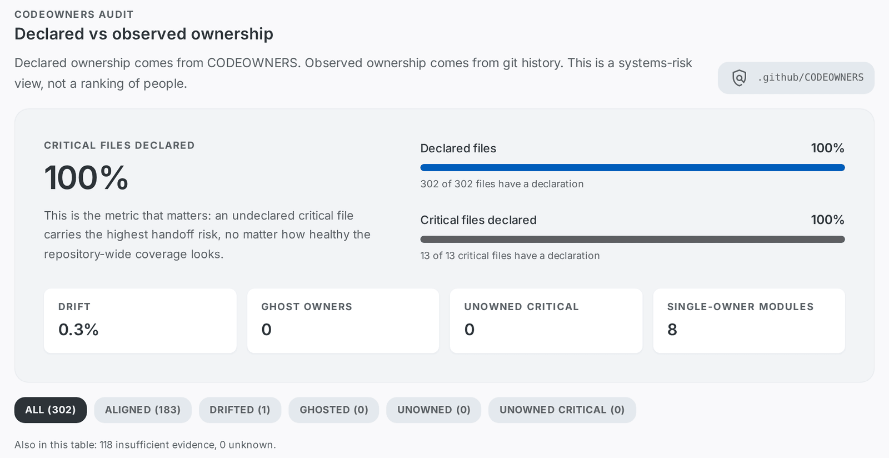

<p align="center">
  
</p>
<h1 align="center">CodeSentinel</h1>
<p align="center">
  <a href="https://github.com/getcodesentinel/codesentinel/actions/workflows/release.yml"></a>&nbsp;
  <a href="https://www.npmjs.com/package/@getcodesentinel/codesentinel"></a>&nbsp;
  <a href="https://nodejs.org/">=22" /></a>&nbsp;
  <a href="https://opensource.org/licenses/MIT"></a>&nbsp;
  <a href="https://getcodesentinel.github.io/codesentinel/"></a>
</p>

**CODEOWNERS says who should know. This says who actually does — and what breaks when they leave.**

```bash
npx @getcodesentinel/codesentinel owners .
```

CodeSentinel reads `CODEOWNERS` and the repository's git history, and shows file by file whether the declared owner is the person who actually maintains the code: who is declared, who commits, where those two disagree, and which critical files have nobody. It runs offline on a local clone, needs no account, and is MIT licensed.

[](https://getcodesentinel.github.io/codesentinel/#change-ownership)

This is this repository's own HTML report (`report --format html`). The live copy, rebuilt on every push to `main`, is at <https://getcodesentinel.github.io/codesentinel/>.

## What it finds

The command above, run on this repository at `0601b86` (302 tracked files, one `CODEOWNERS` entry, 90-day window, minimum two commits per file). Console output, trimmed to the summary block:

```text
Ownership audit — 302 tracked files, window 90d, ref HEAD
CODEOWNERS .github/CODEOWNERS · 1 entry · 0 invalid lines

Declared coverage:        100%  (302/302)
Critical coverage:        100%  (13/13)
Drift:                    0.33%  (1/302 declared files)
Owners without activity:  0 owners
Unowned critical:         0
Single-owner modules:     8
```

Four kinds of finding, one line each:

- **Ghost owner** — a declared owner with no commits in the window. Here: `0`. The single `* @aleixalonso` rule covers every file, and that account does commit.
- **Drift** — the declared owner is not the top author of the file. Here: `1` of 302 declared files. It is the identity case described under [Identity matching is heuristic](#identity-matching-is-heuristic), not a second maintainer.
- **Unowned critical file** — no `CODEOWNERS` rule matches, and the file carries structural or change pressure. Here: `0` of 13 critical files.
- **Single-owner module** — a module whose declared owner never varies. Here: `8`. The HTML report puts the mean bus factor at `1.0`: 334 of the 341 analysed files have a bus factor of 1.

Two of those findings are empty here because this repository has a one-line wildcard rule and a single maintainer, and the audit is supposed to say so instead of manufacturing findings. What the 100% does hide is the point of the tool: one `* @aleixalonso` line takes declared coverage to 100% while telling you nothing about whether the declared owner is the person who maintains the file. The report states it directly: _this is the metric that matters, an undeclared critical file carries the highest handoff risk, no matter how healthy the repository-wide coverage looks_.

On a repository where several teams share one tree, the same command names the files: `owner: @alice · observed dave@example.com (75%)`, `ghosted`, `unowned-critical`. The [sample output](#sample-output) below is one of those runs, and [what the statuses mean](#what-the-statuses-mean) lists every verdict. What the audit cannot see is listed under [Limitations](#limitations).

## How it compares

| Tool                                  | What it measures                                                                                                                                                     | Declared vs observed ownership                                  | Open source                                              | Runs locally                         |
| ------------------------------------- | -------------------------------------------------------------------------------------------------------------------------------------------------------------------- | --------------------------------------------------------------- | -------------------------------------------------------- | ------------------------------------ |
| **CodeSentinel**                      | Declared owners cross-checked against git authorship, plus structural and change-history risk                                                                        | Yes                                                             | Yes, MIT                                                 | Yes, offline, `npx`                  |
| **ESLint**[^eslint]                   | Lint rules and code patterns in JavaScript and TypeScript                                                                                                            | No                                                              | Yes, MIT                                                 | Yes                                  |
| **SonarQube Community Build**[^sonar] | Reliability, security and maintainability issues for the 21 languages Community Build supports (more in the commercial editions); SCM blame is used to assign issues | No, blame data is used for issue assignment, not an owner audit | Yes, LGPL-3.0                                            | Yes, self-managed server             |
| **CodeQL**[^codeql]                   | Semantic queries for vulnerabilities and coding errors, mapped to CWEs                                                                                               | No                                                              | No, GitHub CodeQL Terms (free for open-source codebases) | Yes, CodeQL CLI                      |
| **CodeScene**[^codescene]             | Code Health, hotspots, change coupling, and knowledge distribution with bus-factor simulation                                                                        | Yes, knowledge distribution and bus factor                      | No, proprietary                                          | Yes, CodeScene CLI, account required |

The table compares scope, not quality: these tools answer different questions, and most teams run more than one of them.

[^eslint]: <https://eslint.org/docs/latest/> and <https://github.com/eslint/eslint/blob/main/LICENSE>.

[^sonar]: <https://docs.sonarsource.com/sonarqube-community-build/analyzing-source-code/languages/overview> (21 languages, checked 2026-10-23), <https://docs.sonarsource.com/sonarqube-server/10.7/analyzing-source-code/scm-integration> and <https://github.com/SonarSource/sonarqube>.

[^codeql]: <https://codeql.github.com/docs/> and <https://github.com/github/codeql-cli-binaries/blob/main/LICENSE.md>.

[^codescene]: <https://codescene.com/product> and <https://codescene.io/docs/cli/>.

## Quickstart

### Run the audit

No install, no account, no network. Run it from the repository root:

```bash
npx @getcodesentinel/codesentinel owners .
```

It reads `CODEOWNERS` (`.github/CODEOWNERS`, `CODEOWNERS` or `docs/CODEOWNERS`, in that order) and the git history of the checked-out ref, so a local run and a CI run measure the same revision. Exit codes: `0` when the audit ran, `1` when a configured threshold is exceeded under `--fail-on error`, `2` on a configuration or parse error.

### Add it to a project

```bash
npm install --save-dev @getcodesentinel/codesentinel
npx codesentinel owners .
```

### Generate the report

```bash
npx codesentinel owners . --format md --output ownership.md
npx codesentinel owners . --format sarif --output codesentinel-ownership.sarif
npx codesentinel report . --format html --output codesentinel-report
```

The last command writes a self-contained `codesentinel-report/index.html` with the declared-versus-observed table, filters, hotspot and bus-factor views. The SARIF file is the one GitHub code scanning ingests.

### Wire it into CI

```bash
npx codesentinel init .
```

It writes `.github/workflows/codesentinel.yml` and, when a `CODEOWNERS` file exists, `.codesentinel/owners.json` with the ownership thresholds. Preview with `--dry-run`, overwrite existing files with `--force`.

A full workflow template is at `examples/github-actions/codesentinel-ci.yml`. The smallest workflow that runs the gate is:

```yaml
name: CodeSentinel

on: pull_request

permissions:
  contents: read

jobs:
  codesentinel:
    runs-on: ubuntu-latest
    steps:
      - uses: actions/checkout@v4
        with:
          fetch-depth: 0
      - run: npx --yes @getcodesentinel/codesentinel@latest ci --baseline-ref auto --fail-on error
```

`fetch-depth: 0` is required: `--baseline-ref auto` resolves the baseline from git history.

## Reference

### Ownership audit

`codesentinel owners` cross-checks the owners declared in `CODEOWNERS` against the authors that git history proves, and reports coverage, drift, ghost owners and unowned critical files. The audit is offline by contract: it reads the `CODEOWNERS` file and the tracked tree from `--ref` (default `HEAD`), so CI and a local run measure the same revision.

#### What the statuses mean

- `aligned`: a declared owner is the top author for the file's activity horizon.
- `drifted`: the file has a declaration, but the top author is not one of the declared owners. A dormant file is compared against its lifetime top author.
- `ghosted`: no declared owner has **verified** activity inside the window, and every declared owner is verifiable. A file that is merely dormant (the owner touched it historically, nothing in the window) is not ghosted.
- `unowned`: no `CODEOWNERS` pattern matches the file, or the winning entry has no owners.
- `unowned-critical`: an unowned file is also critical (structural fan-in, hotspot, risk or churn fallback).
- `insufficient-evidence`: fewer lifetime commits than `--min-commits`; no verdict is emitted.
- `unknown`: the audit degraded (an unexpanded team, an unresolved alias). It is not a verdict on the file. An unexpanded team (`@org/team` while offline) is `unknown`, never `ghosted`: absence of evidence is not evidence of absence.

#### Ignoring bot authors

The audit excludes machine accounts from ownership evidence by default. The eight default globs are `*[bot]*`, `*-bot@*`, `*bot@users.noreply.github.com`, `semantic-release-bot@*`, `renovate@*`, `dependabot@*`, `github-actions@*` and `noreply@github.com`.

Matching is case-insensitive and anchored to the full author id or display name: `*` matches any sequence, `?` matches one character, and every other character is literal. Additional patterns extend the defaults in `.codesentinel/owners.json`:

```json
{ "ignoreAuthors": ["*@acme-bot.example"] }
```

Use `--ignore-author <glob>` for a per-run override; it is repeatable and additive. The defaults are always on and cannot be removed. Ignored authors are excluded from the top author, author counts, shares, ghost and drift evidence. When the activity window contains only automated commits, the audit falls back to lifetime human evidence, so a file maintained by humans is not reported as drifted or unknown just because a bot touched it. `codesentinel ci` reads the same `ignoreAuthors` configuration from `.codesentinel/owners.json`, while `--ignore-author` is the `owners` per-run override.

#### Sample output

The following is illustrative output from a small four-file repository (plus its `CODEOWNERS` file), run with `--min-commits 2`:

```
Ownership audit — 5 tracked files, window 90d, ref HEAD
CODEOWNERS CODEOWNERS · 3 entries · 0 invalid lines

Declared coverage:        60%  (3/5)
Critical coverage:        0%  (0/1)
Drift:                    33.33%  (1/3 declared files)
Owners without activity:  1 owner
Unowned critical:         1
Single-owner modules:     3

Unowned critical
  scripts/deploy.txt  fan-in n/a  commits 6  authors 1

Drift — declared owner is not the top recent author
  api/webhooks.txt  declared @alice  observed dave@example.com (75%)

Ghost owners — declared, no commits in the window
  @carol  docs/guide.txt

Warnings
  - No structural analysis available: criticality falls back to hotspots and churn (p90).
```

#### The metric that matters

Coverage over critical files (`declaredCoverageCriticalPercent`) is the metric to watch. A single `* @someone` line takes flat coverage to 100% while the critical files that carry the risk stay orphaned.

#### SARIF output

The SARIF format is intended for GitHub code scanning: upload `codesentinel-ownership.sarif` with `github/codeql-action/upload-sarif` and `category: codesentinel-ownership`. Findings keep stable fingerprints, so code scanning updates the same alerts across runs.

### Risk and health model

CodeSentinel combines three signals into a single, explainable risk profile:

- **Structural risk**: dependency graph topology, cycles, coupling, fan-in/fan-out, boundary violations.
- **Evolutionary risk**: change frequency, hotspots, bus factor, volatility.
- **External risk**: transitive dependency exposure, maintainer risk, staleness and abandonment indicators.
  - Includes bounded popularity dampening (weekly npm downloads) as a secondary stability signal.

The CLI output now includes a deterministic `risk` block composed from those dimensions:

- `riskScore` and `normalizedScore`
- ranked `hotspots`
- `fragileClusters` (structural cycles + change coupling components)
- `dependencyAmplificationZones`
- file/module/dependency score tables

It also includes a deterministic `health` block (`healthScore`, dimension scores, and actionable top issues) computed independently from risk.

The goal is a practical, engineering-grade model that supports both strategic architecture decisions and daily code review workflows.

### CLI reference

Install globally with npm:

```bash
npm install -g @getcodesentinel/codesentinel
```

Then run:

```bash
codesentinel analyze [path]
codesentinel run [path]
codesentinel explain [path]
codesentinel report [path]
codesentinel check [path]
codesentinel ci [path]
codesentinel owners [path]
codesentinel comment --input <file> [--pr <number>] [--comment-on change|always|never]
codesentinel trend --from <dir-or-glob>
codesentinel init [path]
codesentinel dependency-risk <dependency[@version]>
codesentinel update
```

Examples:

```bash
codesentinel run
codesentinel run . --detail full --format text
codesentinel analyze
codesentinel analyze .
codesentinel analyze ../project
codesentinel explain
codesentinel explain . --top 5 --format text
codesentinel explain . --file src/app/page.tsx
codesentinel explain . --module src/components
codesentinel report
codesentinel report --format md --output report.md
codesentinel report --snapshot snapshot.json
codesentinel report --compare baseline.json --format text
codesentinel check --compare baseline.json --max-risk-delta 0.03 --no-new-cycles
codesentinel ci --baseline baseline.json --snapshot current.json --report report.md --fail-on error
codesentinel ci --baseline-ref origin/main --max-risk-delta 0.03 --no-new-cycles
codesentinel ci --baseline-ref auto --fail-on error
codesentinel owners
codesentinel owners . --format md --output ownership.md
codesentinel owners . --format sarif --output codesentinel-ownership.sarif
codesentinel owners . --fail-on error --max-unowned-critical 0 --max-ghost-owners 2 --max-drift 0.25
codesentinel owners . --ignore-author '*@acme-bot.example'
codesentinel comment --input codesentinel-ci.json
codesentinel comment --input codesentinel-ci.json --pr 42 --comment-on change
codesentinel trend --from ./snapshots
codesentinel trend --from './snapshots/*.json' --since 90d --format md --output trend.md
codesentinel init
codesentinel init . --force
codesentinel init . --ci none --dry-run
codesentinel dependency-risk react
codesentinel dependency-risk react@19.0.0
codesentinel update
```

Use `codesentinel update` to manually check for a newer CLI release and install it without waiting for the startup notifier.

`codesentinel owners` cross-checks the owners declared in `CODEOWNERS` with the authors that history proves. It is offline, reads the `CODEOWNERS` file and the tracked tree from `--ref` so CI and a local run measure the same revision, and exits with `0` when the audit ran, `1` when a configured threshold is exceeded under `--fail-on error`, and `2` on a configuration or parse error (an untracked `CODEOWNERS`, an invalid flag value, or a file above GitHub's 3 MB limit). A repository without a `CODEOWNERS` file reports `available: false` and still exits `0`. Machine accounts are excluded from the evidence by default; use `--ignore-author <glob>` to add repository-specific patterns.

Use `--format sarif` to emit SARIF 2.1.0 for GitHub code scanning. Each ownership finding maps to one of the four rules (`ownership/unowned-critical`, `ownership/ghost-owner`, `ownership/drift`, `ownership/unknown`), points at line 1 of the file, and links back to the matching `CODEOWNERS` line when one exists. Results carry stable `codesentinel/v1` partial fingerprints derived only from the rule id and the relative path, so repeated uploads deduplicate instead of opening duplicate alerts. Upload it with `github/codeql-action/upload-sarif` and the `codesentinel-ownership` category. When no `CODEOWNERS` file exists the log still declares all four rules and contains zero results.

`codesentinel comment --input <file>` renders the sticky pull request summary from the JSON written by `codesentinel ci --json-output`. Pass `--pr <number>` to upsert it through the GitHub API; the token is read from `GITHUB_TOKEN` only, never a flag, and `--repository` defaults to `GITHUB_REPOSITORY`. The comment is marked with `<!-- codesentinel:summary -->`, so later runs update it in place instead of creating another comment. `--comment-on change` (the default) skips the API update when nothing moved, `always` refreshes it unconditionally, and `never` renders without posting. Without `--pr` the command is a local renderer and prints the body to stdout unless `--output <file>` is given.

`codesentinel init [path]` scaffolds a working CI setup in the target repository. It writes `.github/workflows/codesentinel.yml` and, when a `CODEOWNERS` file exists, `.codesentinel/owners.json`. The workflow runs `codesentinel ci --baseline-ref auto --fail-on error --snapshot codesentinel-snapshot.json --json-output codesentinel-ci.json`, builds an ownership report and a SARIF file when a `CODEOWNERS` file is present, uploads the SARIF to GitHub code scanning, posts the sticky pull request summary, and uploads the snapshot and report artifacts with 90-day retention. The uploaded snapshot includes ownership data when a `CODEOWNERS` file exists, so `codesentinel trend` can chart ownership history from those artifacts. Use `--force` to overwrite existing generated files, `--ci none` to skip the workflow (for example when CI lives elsewhere), or `--dry-run` to print what would be written without changing anything. Existing files are never overwritten without `--force`, and the command never edits `package.json`.

Author identity mode:

```bash
# Default: heuristic merge of likely same person across emails
codesentinel analyze . --author-identity likely_merge

# Deterministic: strict email identity, no heuristic merging
codesentinel analyze . --author-identity strict_email

# Personal-project profile (down-weights single-maintainer ownership penalties)
codesentinel analyze . --scoring-profile personal

# Tune recency window (days) used for evolution volatility
codesentinel analyze . --recent-window-days 60

# Quiet mode (only JSON output)
codesentinel analyze . --log-level silent

# Verbose diagnostics to stderr
codesentinel analyze . --log-level debug

# Default compact output (summary)
codesentinel analyze .

# Full output (all sections and detailed arrays)
codesentinel analyze . --output json
codesentinel analyze . --json

# Explain top hotspots with narrative output
codesentinel explain .

# Explain a specific file
codesentinel explain . --file src/app/page.tsx

# Explain a specific module
codesentinel explain . --module src/components

# Explain in markdown or json
codesentinel explain . --format md
codesentinel explain . --format json
codesentinel explain . --recent-window-days 60

# Report generation (human + machine readable)
codesentinel report .
codesentinel report . --format md --output report.md
codesentinel report . --format json
codesentinel report . --snapshot snapshot.json
codesentinel report . --compare baseline.json --format text
```

Notes:

- `likely_merge` (default) may merge multiple emails that likely belong to the same person based on repository history.
- `strict_email` treats each canonical email as a distinct author, which avoids false merges but can split the same person across multiple emails.
- Git mailmap is enabled (`git log --use-mailmap`). Put `.mailmap` in the repository being analyzed (the `codesentinel analyze [path]` target). Git will then deterministically unify known aliases before CodeSentinel computes ownership distributions.
- Evolution output includes both `authorDistributionByCommits` and `authorDistributionByChurn`, plus their derived `topAuthorShare...` and `busFactor...` fields.
- Current scoring continues to use the commit-weighted ownership view (`...ByCommits`).
- Logs are emitted to `stderr` and JSON output is written to `stdout`, so CI redirection still works.
- You can set a default log level with `CODESENTINEL_LOG_LEVEL` (`silent|error|warn|info|debug`).
- At `info`/`debug`, structural, evolution, and dependency stages report progress so long analyses are observable.
- `--output summary` (default) prints a compact result for terminal use.
- `--output json` (or `--json`) prints the full analysis object.
- `--recent-window-days <days>` customizes the git recency window used to compute `recentVolatility` (default: `30`).
- `--scoring-profile default|personal` selects scoring profile.
  - `default`: balanced team-oriented defaults.
  - `personal`: lowers single-maintainer ownership penalties for both risk and health ownership scoring.
  - `personal` does not remove structural, churn, volatility, external, or interaction risk; scores can still be elevated when those signals are high.

When running through pnpm, pass CLI arguments after `--`:

```bash
pnpm dev -- analyze
pnpm dev -- analyze .
pnpm dev -- analyze ../project
pnpm dev -- analyze . --author-identity strict_email
pnpm dev -- run . --format text
pnpm dev -- explain
pnpm dev -- explain . --top 5 --format text
pnpm dev -- explain . --file src/app/page.tsx
pnpm dev -- report
pnpm dev -- report . --format md --output report.md
pnpm dev -- report . --compare baseline.json --format text
pnpm dev -- check . --compare baseline.json --max-risk-delta 0.03 --no-new-cycles
pnpm dev -- ci . --baseline baseline.json --snapshot current.json --report report.md --fail-on warn
```

### Report output

`codesentinel report` produces deterministic engineering artifacts from existing analysis outputs.

- default format: `md`
- formats: `text`, `md`, `json`, `html` (`--format html` writes a self-contained `index.html` into the `--output` directory)
- optional file output: `--output <path>`
- optional snapshot export: `--snapshot <path>`
- optional diff mode: `--compare <baseline.json>`

Diff mode compares snapshots and reports:

- repository score deltas
- file/module risk deltas
- new/resolved hotspots
- new/resolved cycles
- dependency exposure list changes

The live report at <https://getcodesentinel.github.io/codesentinel/> is this project's own HTML report generated by CodeSentinel from this repository and refreshed on every push to `main`.

### Run output

`codesentinel run` is a convenience command that emits `analyze + explain + report` in one execution.

- formats: `text`, `md`, `json` (`md` default)
- detail levels: `--detail compact|standard|full` (`compact` default, `full` = full verbose sections)
- explain target selectors: `--file <path>`, `--module <name>`, `--top <n>`
- report diff/snapshot flags: `--compare <baseline.json>`, `--snapshot <path>`, `--no-trace`

### CI mode

`codesentinel check` evaluates enforcement gates against current analysis (and optional baseline diff).

Supported gates:

- `--max-risk-delta <value>`
- `--max-health-delta <value>`
- `--no-new-cycles`
- `--no-new-high-risk-deps`
- `--max-new-hotspots <count>`
- `--max-risk-score <score>`
- `--min-health-score <score>`
- `--new-hotspot-score-threshold <score>`
- `--max-unowned-critical <count>` (ci only; requires a `CODEOWNERS` file)
- `--max-ghost-owners <count>` (ci only; requires a `CODEOWNERS` file)
- `--max-drift <ratio>` (ci only; requires a `CODEOWNERS` file)
- `--fail-on error|warn`

The ownership gates are a no-op with an explicit warning when no `CODEOWNERS` file is found. They never pass silently.

Ownership violations are error-level, so `--fail-on` never softens them; `--fail-on warn` only adds warn-level gates such as `--max-new-hotspots`.

`codesentinel ci` orchestrates snapshot + diff + gate evaluation + markdown summary generation.

`--snapshot <path>` writes a `codesentinel.snapshot.v2` artifact. Whenever a `CODEOWNERS` file exists, the snapshot embeds the ownership audit block (`ownership`) independently of the ownership thresholds, which only control enforcement. It also records `source.commit` (the full SHA) and `source.ref`, so `trend` can show the revision each run measured.

Baseline input modes:

- `--baseline <path>`: use an existing snapshot JSON artifact.
- `--baseline-ref <git-ref>`: resolve baseline from git (`origin/main`, `main`, `HEAD~1`) using an isolated temporary worktree. No checkout/stash of your current working tree.
- `--baseline-ref auto`: deterministic resolver with ordered fallbacks:
  - `--baseline-sha <sha>` if provided.
  - CI base branch env vars (`GITHUB_BASE_REF`, `CI_MERGE_REQUEST_TARGET_BRANCH_NAME`, `BITBUCKET_PR_DESTINATION_BRANCH`) with `origin/<branch>` first, then `<branch>`.
  - branch-aware defaults:
    - on `main/master`: `HEAD~1`
    - otherwise: `merge-base(HEAD, origin/main)` then `origin/master`, `main`, `master`
- `--main-branch <name>` (repeatable) or `--main-branches "main,master,trunk"` customize default branch candidates used by `--baseline-ref auto`.

The workflow generated by `codesentinel init` now uploads ownership SARIF to code scanning and posts the sticky pull request summary, so it needs `security-events: write` and `pull-requests: write` in addition to `contents: read`. If your repository manages permissions centrally, grant those two explicitly or the SARIF upload and comment steps will fail.

GitHub Actions recommendation for deterministic CI with `--baseline-ref auto`:

```yaml
- uses: actions/checkout@v4
  with:
    fetch-depth: 0
    filter: blob:none
    ref: ${{ github.event.pull_request.head.sha || github.sha }}

- name: Ensure git history for CodeSentinel
  run: |
    set -euo pipefail
    git fetch --prune --unshallow || true
    BASE_REF="${GITHUB_BASE_REF:-main}"
    git fetch origin "+refs/heads/${BASE_REF}:refs/remotes/origin/${BASE_REF}"
```

This repository runs CodeSentinel on its own pull requests. `.github/workflows/codesentinel.yml`
builds the CLI from the checked-out revision and runs `ci --baseline-ref auto` with risk `<= 52`,
health `>= 80`, risk delta `<= 1`, no new cycles and no new hotspots against `main`; it uploads
the ownership SARIF to code scanning under the `codesentinel-ownership` category, keeps one sticky
summary comment per pull request, and stores the snapshot as a 90-day artifact.

Exit codes:

- `0`: no failing violations
- `1`: error-level violations
- `2`: warn-level violations when `--fail-on=warn`
- `3`: invalid configuration
- `4`: internal execution error

### Trend

`codesentinel trend` reads snapshot JSON artifacts written by `codesentinel ci --snapshot` and prints the series over time. Snapshots are CI artifacts, not repository files: `trend` never writes history into the repository and never changes the snapshot schema.

The workflow generated by `codesentinel init` runs `codesentinel ci --snapshot` and uploads the result as the `codesentinel` artifact, retrievable with `gh run download <run-id> -n codesentinel`. The ownership columns (Unowned, Ghosts, Drift) are populated from the snapshot's embedded ownership block, and the Commit column shows the short SHA. Both `codesentinel.snapshot.v2` and legacy `codesentinel.snapshot.v1` artifacts are read; v1 snapshots have no commit, so Commit shows `—`.

```bash
codesentinel trend --from ./snapshots
codesentinel trend --from './snapshots/*.json' --since 90d --last 12 --format md --output trend.md
```

`--from` accepts a directory (non-recursive `*.json` files) or a glob pattern. Each snapshot is parsed independently: a corrupt file, an unsupported schema version or a missing score is skipped with a warning so the remaining history still renders. Series are ordered by `generatedAt`, duplicate timestamp and commit pairs are collapsed, and `--since <N>d`/`--last <N>` narrow the window. Output is available as `console` (default), `json` (stable payload) and `md`. Deltas are last minus first; ownership deltas stay `null` when either endpoint has no ownership block. Fewer than two snapshots still exits `0` and prints `not enough history for a trend`. Configuration errors exit `2`.

### Reading path

`codesentinel path` prints an ordered, explainable reading path for a module directory or a single file. It uses the existing CodeSentinel structural graph, git evolution history and, when present, `CODEOWNERS`. The command is offline, local and deterministic: the same repository state produces the same output.

#### Quickstart

```bash
codesentinel path packages/ownership
```

#### Sample output

The following is the real console output for `packages/ownership`:

```text
Reading path: packages/ownership (directory)
8 steps (truncated)

 1. packages/ownership/src/index.ts  [entry]
    entry: highest external fan-in (4 imports from outside the module)
    owner: @aleixalonso · observed: aleixalonso@hotmail.com · commits 3 · churn 99 · fan-in 0
 2. packages/ownership/src/domain/codeowners.ts  [core]
    most changed together with packages/ownership/src/index.ts (3 commits)
    owner: @aleixalonso · observed: aleixalonso@hotmail.com · commits 4 · churn 135 · fan-in 8
 3. packages/ownership/src/application/audit-ownership.ts  [helper]
    most changed together with packages/ownership/src/domain/codeowners.ts (3 commits)
    owner: @aleixalonso · observed: aleixalonso@hotmail.com · commits 3 · churn 392 · fan-in 2
    tests: packages/ownership/src/application/audit-ownership.test.ts
 4. packages/ownership/src/domain/classify.ts  [core]
    most changed together with packages/ownership/src/application/audit-ownership.ts (3 commits)
    owner: @aleixalonso · observed: aleixalonso@hotmail.com · commits 3 · churn 215 · fan-in 4
    tests: packages/ownership/src/domain/classify.test.ts
 5. packages/ownership/src/domain/identity.ts  [core]
    central inside the module: 4 importers
    owner: @aleixalonso · observed: aleixalonso@hotmail.com · commits 1 · churn 62 · fan-in 4
 6. packages/ownership/src/application/ignore-authors.ts  [core]
    central inside the module: 5 importers
    owner: @aleixalonso · observed: aleixalonso@hotmail.com · commits 1 · churn 68 · fan-in 5
    tests: packages/ownership/src/application/ignore-authors.test.ts
 7. packages/ownership/src/application/resolve-identities.ts  [helper]
    most churned neighbour (348 lines changed)
    owner: @aleixalonso · observed: aleixalonso@hotmail.com · commits 2 · churn 348 · fan-in 3
    tests: packages/ownership/src/application/resolve-identities.test.ts
 8. packages/ownership/src/application/parse-codeowners.ts  [core]
    central inside the module: 4 importers
    owner: @aleixalonso · observed: aleixalonso@hotmail.com · commits 1 · churn 157 · fan-in 4
    tests: packages/ownership/src/application/parse-codeowners.test.ts

People to ask
 - aleixalonso@hotmail.com (18 commits): packages/ownership/src/application/audit-ownership.ts, packages/ownership/src/application/ignore-authors.ts, packages/ownership/src/application/parse-codeowners.ts, packages/ownership/src/application/resolve-identities.ts, packages/ownership/src/domain/classify.ts, packages/ownership/src/domain/codeowners.ts, packages/ownership/src/domain/identity.ts, packages/ownership/src/index.ts

Suggested commands (not discovered, not run)
 - pnpm test

Warnings
 - showing 8 of 10 files (truncated)
```

#### Flags

| Flag                   | Description                                                                                               |
| ---------------------- | --------------------------------------------------------------------------------------------------------- |
| `target`               | File or directory to read, relative to the repository root.                                               |
| `--max-steps <count>`  | Maximum number of files in the reading path (1..25). Default `8`.                                         |
| `--format <mode>`      | Output format: `console` (default), `md` or `json`.                                                       |
| `--output <file>`      | Write the rendered output to a file instead of stdout.                                                    |
| `--window-days <days>` | Ownership observation window in days. Default `90`.                                                       |
| `--include-tests`      | Include test files as their own steps instead of attaching them to their source.                          |
| `--ref <ref>`          | Git ref to read CODEOWNERS and the tracked history from. Default `HEAD`.                                  |
| `--log-level <level>`  | Log verbosity: `silent`, `error`, `warn`, `info` or `debug` (logs are written to stderr). Default `info`. |

#### Formats

`console` is the default. `md` produces the same content as a Markdown document that drops into a pull request. `json` emits a stable payload that is byte-identical across runs on the same repository state.

```json
{
  "schemaVersion": "codesentinel.path.v1",
  "target": "packages/ownership",
  "targetKind": "directory",
  "steps": [
    {
      "order": 1,
      "filePath": "packages/ownership/src/index.ts",
      "role": "entry",
      "reason": "entry: highest external fan-in (4 imports from outside the module)",
      "owner": [
        {
          "kind": "user",
          "handle": "aleixalonso"
        }
      ],
      "observedTopAuthor": "aleixalonso@hotmail.com",
      "commits": 3,
      "churn": 99,
      "fanInInternal": 0,
...
```

The payload keys are `schemaVersion`, `target`, `targetKind`, `steps`, `people`, `commands`, `warnings`, `truncated`.

#### How the order is chosen

The entry step is chosen in five steps:

1. **Seed file.** When the target is a single file, that file is the entry.
2. **Single-file module.** When the steppable universe contains a single file, that file is the entry.
3. **Package index.** For a directory target, a file directly at the target root is the entry when it is named `index.ts`, `index.tsx`, `main.ts`, `mod.ts` or `public-api.ts` (checked in that order). The file must be part of the steppable universe: a test file excluded by default does not trigger this rule.
4. **Highest external fan-in.** Otherwise the file with the most imports from outside the module is the entry. When several files share that maximum, the one with the highest internal fan-out wins: the file that imports the most distinct files inside the module. This tie-break reports `entry: highest internal fan-out (N imports inside the module)`. If the fan-out maximum is zero, or files still tie, the shortest path and then alphabetical order decide, and the reason reports the external-fan-in rule.
5. **Highest internal fan-in.** When every file has zero external fan-in, the file with the most importers inside the module is the entry. Ties use the same shortest-then-alphabetical breakers.

A single-file target still starts at that file. From there a greedy walk scores change coupling at 0.5, internal fan-in at 0.3 and churn at 0.2. When the walk is exhausted it jumps to the highest remaining internal fan-in. Every step carries the signal that selected it, and its role is one of `entry`, `core`, `helper` or `test`. The git-only fallback (no structural graph) orders by churn and change coupling and does not apply the package-index rule.

#### Degraded and edge behaviour

- No `CODEOWNERS` file: `owner` is `null`.
- No structural graph: ordering falls back to git history only and a warning is emitted.
- Fewer files than `--max-steps`: `truncated` is `false`.
- More files than `--max-steps`: `truncated` is `true` and a warning records how many files were shown.
- A target outside the repository, a missing target or invalid flags exit `2`; success exits `0`.

### Explain output

`codesentinel explain` uses the same risk-engine scoring model as `analyze` and adds structured explanation traces.

Text/markdown output includes:

- repository score and risk band (`low|moderate|elevated|high|very_high`)
- repository dimension scores (`structural`, `evolution`, `external`, `interactions`) as `0-100`
- plain-language primary drivers
- concrete evidence values behind those drivers
- intersected signals (composite interaction terms)
- prioritized reduction actions
- per-target breakdowns (repository/file/module/dependency, depending on selection)

Filters:

- `--file <path>`: explain one file target.
- `--module <name>`: explain one module target.
- `--top <n>`: explain top `n` hotspot files (default behavior when no file/module is provided).
- `--format text|json|md`: render narrative text, full JSON payload, or markdown.

### Reading analyze output

`codesentinel analyze` returns one JSON document with five top-level blocks:

- `structural`: file dependency graph shape and graph metrics.
- `evolution`: git-derived change behavior per file and coupling pairs.
- `external`: dependency exposure for direct packages plus propagated transitive signals.
- `risk`: deterministic composition of `structural + evolution + external`.
- `health`: deterministic code health posture from local structural/evolution/test signals.

Minimal shape:

```json
{
  "structural": { "...": "..." },
  "evolution": { "...": "..." },
  "external": { "...": "..." },
  "risk": {
    "riskScore": 0,
    "normalizedScore": 0,
    "hotspots": [],
    "fragileClusters": [],
    "dependencyAmplificationZones": []
  },
  "health": {
    "healthScore": 0,
    "normalizedScore": 0,
    "dimensions": {
      "modularity": 0,
      "changeHygiene": 0,
      "testHealth": 0,
      "ownershipDistribution": 0
    },
    "topIssues": [],
    "trace": {
      "schemaVersion": "1",
      "dimensions": []
    }
  }
}
```

How to read `risk` first:

- `riskScore`: overall repository fragility index (`0..100`).
- `hotspots`: ranked files to inspect first.
- `fragileClusters`: groups of files with structural-cycle or co-change fragility.
- `dependencyAmplificationZones`: files where external dependency pressure intersects with local fragility.

Score direction:

- `risk.riskScore`: higher means higher risk (worse).
- `health.healthScore`: higher means better health posture.
- Report views also include derived tiers: `riskTier` and `healthTier`.
- `health.trace`: per-dimension factor traces with normalized metrics and evidence.

Health dimensions:

- `modularity`: cycle density + fan/centrality concentration + structural-hotspot overlap.
- `changeHygiene`: churn/volatility concentration + dense co-change clusters.
- `testHealth`: test presence + test-to-source ratio + testing directory presence.
- `ownershipDistribution`: top-author share + author entropy + single-author dominance signals.

Signal ingestion (deterministic, local):

- Structural and evolution metrics come from local graph + git analysis.
- Test posture uses file/path heuristics only (no mandatory coverage integration).
- Ownership posture is derived from local git author distribution metrics.

Interpretation notes:

- Scores are deterministic for the same inputs and config.
- Scores are meant for within-repo prioritization and trend tracking.
- Full model details and limits are in `packages/risk-engine/README.md`.

#### Risk score guide

Use these ranges as operational guidance:

- `0-20`: low fragility (architectural and change pressure signals are generally contained).
- `20-40`: moderate fragility (localized hotspots exist; monitor trend direction and concentration).
- `40-60`: elevated fragility (prioritize top hotspots before introducing major concurrent change).
- `60-80`: high fragility (expect higher coordination cost, regressions, and change coupling across areas).
- `80-100`: very high fragility (treat as immediate triage; focus on stabilization before further expansion).

These ranges are heuristics for triage, not incident probability.

#### Health score guide

Use these ranges as operational guidance:

- `0-20`: critical health posture (maintainability pressure is highly concentrated and debt is likely compounding).
- `20-40`: weak health posture (key maintainability bottlenecks are visible; prioritize stabilization work).
- `40-60`: fair health posture (baseline is workable, but concentrated architecture/change pressure can still slow delivery).
- `60-80`: good health posture (most maintainability signals are stable, with targeted improvements still valuable).
- `80-100`: excellent health posture (maintainability pressure is broadly distributed and sustainably controlled over time).

These ranges are heuristics for prioritization, not absolute quality guarantees.

#### What moves scores

`risk.riskScore` and `risk.fileScores[*].score` increase when:

- structurally central files/modules change frequently,
- ownership is highly concentrated in volatile files,
- files in central areas are exposed to high external dependency pressure,
- tightly coupled change patterns emerge.

They decrease when:

- change concentrates less around central files,
- ownership spreads or volatility decreases,
- dependency pressure decreases (shallower trees, fewer high-risk signals),
- hotspot concentration drops.

#### External risk signals

For `external.dependencies`, each direct dependency now exposes three signal fields:

- `ownRiskSignals`: signals computed from that package itself.
- `inheritedRiskSignals`: signals propagated from transitive dependencies in its subtree.
- `riskSignals`: union of `ownRiskSignals` and `inheritedRiskSignals`.

Data source notes:

- Lockfile-first extraction supports `pnpm-lock.yaml`, `package-lock.json` / `npm-shrinkwrap.json`, `yarn.lock`, and `bun.lock`.
- If no lockfile is present, CodeSentinel attempts a bounded npm registry graph resolution from direct dependencies.
- npm weekly download metadata is fetched only for direct dependencies (not all transitive nodes).

Classification lists:

- `highRiskDependencies`: **production** direct packages classified from strong **own** signals (not inherited-only signals).
- `highRiskDevelopmentDependencies`: same classification model for direct development dependencies.
- `transitiveExposureDependencies`: direct packages carrying inherited transitive exposure signals.

Current high-risk rule for direct dependencies:

- mark high-risk if own signals include `abandoned`, or
- mark high-risk if at least two of own signals are in `{high_centrality, deep_chain, high_fanout}`, or
- mark high-risk if own signals include `single_maintainer` and the package is stale (>= half abandoned threshold) or has no recent repository activity signal.

Propagation policy is explicit and deterministic:

- `single_maintainer`: **not propagated**
  - Rationale: maintainer concentration is package-specific governance, not a transferable property.
- `abandoned`: **propagated**
  - Rationale: depending on abandoned transitive packages is still real operational exposure.
  - Note: `abandonedDependencies` list only includes packages with **own** `abandoned`.
- `high_centrality`: **propagated**
  - Rationale: highly central transitive packages can become systemic weak points for a parent dependency.
- `deep_chain`: **propagated**
  - Rationale: deep transitive trees increase update/debug complexity for top-level dependencies.
- `high_fanout`: **propagated**
  - Rationale: broad transitive fan-out increases blast radius and maintenance surface.
- `metadata_unavailable`: **not propagated**
  - Rationale: unknown metadata for one child should not automatically degrade parent classification.

This keeps package-level facts local while still surfacing meaningful transitive exposure.

### MCP server

`codesentinel mcp` serves the ownership, risk, trend and reading-path data that CodeSentinel already computes to MCP clients over stdio. It uses JSON-RPC on stdin/stdout and writes every log to stderr. All tools are read-only except `run_scan`, which analyzes the repository and writes a snapshot under `.codesentinel/snapshots`.

#### Register it

Claude Code:

```bash
claude mcp add codesentinel --env CODESENTINEL_ROOT=/absolute/path/to/repository -- codesentinel mcp
```

Claude Desktop (`claude_desktop_config.json`):

```json
{
  "mcpServers": {
    "codesentinel": {
      "command": "npx",
      "args": ["-y", "@getcodesentinel/mcp"],
      "env": { "CODESENTINEL_ROOT": "/absolute/path/to/repository" }
    }
  }
}
```

Cursor (`.cursor/mcp.json`):

```json
{
  "mcpServers": {
    "codesentinel": {
      "command": "npx",
      "args": ["-y", "@getcodesentinel/mcp"],
      "env": { "CODESENTINEL_ROOT": "/absolute/path/to/repository" }
    }
  }
}
```

VS Code (`.vscode/mcp.json`):

```json
{
  "servers": {
    "codesentinel": {
      "type": "stdio",
      "command": "npx",
      "args": ["-y", "@getcodesentinel/mcp"],
      "env": { "CODESENTINEL_ROOT": "/absolute/path/to/repository" }
    }
  }
}
```

Set `CODESENTINEL_ROOT` whenever the client does not start the process from the repository root. `codesentinel mcp` and `npx -y @getcodesentinel/mcp` launch the same server; the wrapper only forwards arguments.

#### Tools

| Tool               | Parameters                                                    | Returns                                                                                 | Read-only |
| ------------------ | ------------------------------------------------------------- | --------------------------------------------------------------------------------------- | --------- |
| `get_file_owner`   | `path`                                                        | Declared owners, observed authorship, criticality and warnings for one tracked file.    | yes       |
| `get_file_risk`    | `path`, `ref?` (only `HEAD`)                                  | File risk score, normalized score, factor breakdown, hotspot rank and repository score. | yes       |
| `get_reading_path` | `target`, `maxSteps?`                                         | Ordered reading steps with roles, reasons, owners, people and suggested commands.       | yes       |
| `get_trend`        | `metric`, `path?` (unsupported), `since?`, `until?`           | Repository-level metric series from snapshot artifacts, oldest to newest.               | yes       |
| `list_hotspots`    | `limit?`, `cursor?`                                           | Ranked hotspots with cursor pagination.                                                 | yes       |
| `run_scan`         | `path?`, `changedOnly?`                                       | Fresh analysis written to a new snapshot file, plus scope and changed-file hotspots.    | no        |
| `search_findings`  | `path?`, `severity?`, `rule?`, `status?`, `cursor?`, `limit?` | Ownership findings with severity, status, message and CODEOWNERS line.                  | yes       |

A real `get_file_owner` call against this repository:

```json
{
  "path": "packages/ownership/src/index.ts",
  "ref": "HEAD",
  "owners": [{ "kind": "user", "value": "@aleixalonso" }],
  "teams": [],
  "status": "aligned",
  "matchLine": 1,
  "topAuthor": { "id": "aleixalonso@users.noreply.github.com", "share": 1 },
  "observed": {
    "commits": 3,
    "recentCommits": 3,
    "authors": 1,
    "dormant": false,
    "busFactor": null,
    "lastCommitUnix": 1792689223
  },
  "criticality": { "isCritical": true, "isHotspot": false, "fanIn": 5, "riskScore": null },
  "warnings": [
    "Ignored 183 commits attributed to 3 ignored authors matched by \"ignoreAuthors\": 29139614+renovate[bot]@users.noreply.github.com, 49699333+dependabot[bot]@users.noreply.github.com, semantic-release-bot@martynus.net."
  ]
}
```

The full request/response capture is in [`docs/mcp-transcript.md`](docs/mcp-transcript.md).

#### Security

No credentials are accepted as tool arguments. Git and CI credentials come from the environment (credential helper, SSH agent or CI token), and error messages are redacted. Stdout carries only MCP messages; logs go to stderr. The server never accepts a token, password or remote URL as a tool input.

#### Trend source

`get_trend` reads snapshots from `CODESENTINEL_SNAPSHOTS_DIR`, defaulting to `<root>/.codesentinel/snapshots`. Snapshots are repository-level, so `get_trend` does not support `path`; use `search_findings` or `get_file_risk` for per-file questions.

### Monorepo layout

- `packages/core`: shared domain types and cross-cutting services.
- `packages/code-graph`: source graph analysis primitives.
- `packages/git-analyzer`: Git history and evolutionary signals.
- `packages/dependency-firewall`: external dependency and supply chain signals.
- `packages/risk-engine`: risk aggregation and scoring model.
- `packages/health-engine`: health posture aggregation and scoring model.
- `packages/reporter`: structured report output (console, JSON, CI).
- `packages/governance`: CI gate evaluation and enforcement policy checks.
- `packages/ownership`: declared ownership signals (CODEOWNERS parsing and matching).
- `packages/cli`: user-facing CLI entrypoint.

Each package is standalone, ESM-only, TypeScript-first, and built with `tsup`. The CLI depends on `core`; domain packages are kept decoupled to avoid circular dependencies.

### Requirements

- Node.js 22+
- pnpm

### Workspace commands

- `pnpm install`
- `pnpm build`
- `pnpm dev`
- `pnpm test`
- `pnpm release`

### ESM import policy

- The workspace uses `TypeScript` with `moduleResolution: "NodeNext"` and ESM output.
- For local relative imports, use `.js` specifiers in source files (example: `import { x } from "./x.js"`).
- Do not use `.ts` specifiers for runtime imports in package source files.
- This keeps emitted code and runtime resolution aligned with Node.js ESM behavior.

## Limitations

### Commits are a biased proxy for knowledge

A commit records what was written and merged, not what is understood. Design discussions, code review, pairing, incidents and questions answered in chat leave no trace in git history, so a file whose owner only reviews it looks unowned.

### No tacit knowledge

CodeSentinel cannot see review activity, issue triage, documentation upkeep, or the person everyone asks when a module breaks. The audit is one signal about coordination risk, not a map of what a team knows. Documentation maintenance is invisible as well: documentation pages are not tracked as knowledge carriers.

### No individual rankings

The audit measures system risk, not individual performance. It emits no owner or author ranking, drift is a coordination signal rather than a fault, and the output must not be used to evaluate people.

### What `unknown` means

`unknown` means the audit degraded: an unexpanded `@org/team` while offline, or an unresolved alias. It is not a verdict on the file, and absence of evidence is not evidence of absence. A file with fewer than `--min-commits` lifetime commits is `insufficient-evidence` instead and gets no verdict at all.

### Identity matching is heuristic

Declared handles are matched to commit authors by noreply address, email local part, display name and the alias map in `.codesentinel/owners.json`. When that fails, the same person appears twice. This repository has one such case: `pnpm-workspace.yaml` is reported as drifted because the audit cannot prove that the declared `@aleixalonso` and the author `aleixalonso@hotmail.com` are the same account. A `.mailmap`, or an `aliases` entry in `.codesentinel/owners.json`, removes the ambiguity.

### Ownership parsing and scope

- No `!` negation and no `[ ]` character classes: they are literal characters, same as GitHub.
- Matching is case-sensitive on every platform, including macOS.
- A `CODEOWNERS` file above 3 MB is rejected (`codeowners_too_large`).
- `CODEOWNERS` is read per ref/branch, so a run measures the ref you pass, and a PR that edits `CODEOWNERS` is measured against the base ref in CI.
- Teams are opaque offline and stay `unknown` unless resolved; `--resolve-github` is accepted but not implemented in this iteration.
- The universe is tracked files only: untracked, ignored and binary-only files are out of scope.
- A repository without a `CODEOWNERS` file reports `available: false` and still exits `0`.
- The repository must be a git work tree with tracked files: the audit reads `git log` and the tracked tree.

### Reading path and history

- The reading path orders files by change coupling, fan-in and churn. It is a suggestion, not a curriculum, and its `pnpm test` line is never run.
- `--ref` pins `CODEOWNERS` and the tracked history, while the structural graph and churn come from the working tree.
- CI needs full history (`fetch-depth: 0`): a shallow clone degrades `--baseline-ref auto` and the ownership window.
- Scores are deterministic heuristics for within-repository prioritisation and trend tracking, not an absolute quality guarantee, and they are not meant for comparing repositories.

## License

MIT
